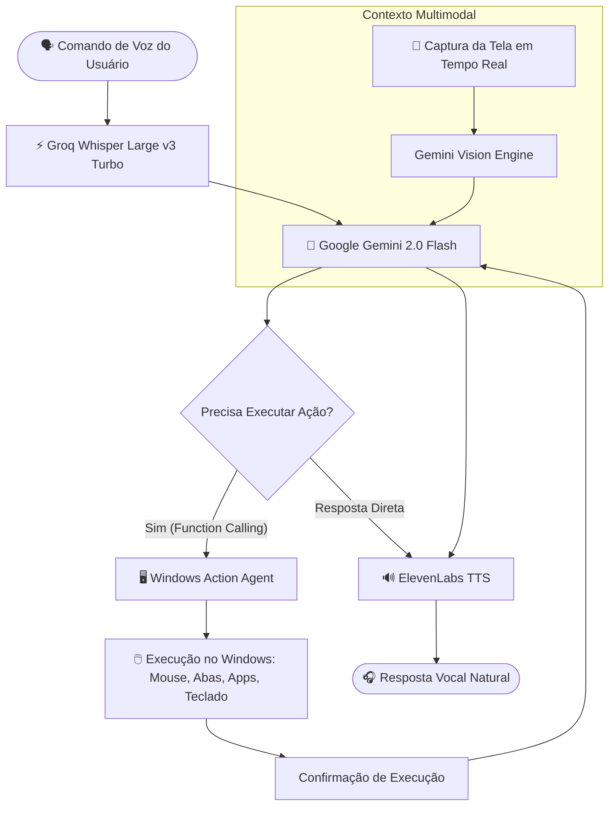

# 🎙️ Multimodal AI Desktop Action Assistant


Assistente multimodal de voz e visão computacional de alta performance para **automação e controle do sistema operacional Windows**. Diferente de chatbots convencionais que apenas respondem texto, este assistente **interpreta comandos de voz, enxerga a tela do computador em tempo real e executa ações práticas no sistema operacional** utilizando mais de 40 ferramentas integradas e Function Calling.

---

## 🚀 Destaques e Capacidades

- 🧠 **Raciocínio & Visão Multimodal (Google Gemini 2.0 Flash):** Capacidade de analisar capturas de tela instantâneas para interpretar o contexto visual atual e decidir quais ferramentas acionar.
- ⚡ **Transcrição em Tempo Real (Groq Whisper Large v3 Turbo):** Latência mínima de Speech-to-Text (STT) para reconhecimento preciso de comandos em português brasileiro.
- 🔊 **Voz Humanizada Ultrarrealista (ElevenLabs TTS):** Síntese vocal de ponta com entonação fluida e natural.
- 🖱️ **Automação Ativa do Windows (40+ Tools):**
  - Controle de mouse e teclado (cliques em coordenadas, digitação, atalhos).
  - Gestão de janelas e abas do navegador (abrir, fechar, alternar, pesquisar).
  - Execução de aplicativos nativos (calculadora, editor de código, reprodutor de mídia).
  - Controle de volume, brilho e utilitários de sistema.
- 📊 **Monitoramento de Taxa & Economia (Rate Limiter Integrado):** Gestão visual inteligente de requisições por minuto e por dia para operar continuamente dentro do free tier das APIs.
- 🎨 **Interface Web Moderna (React + Vite + TypeScript):** Dashboard com visualizador de status, medidores de áudio, logs de execução e métricas de consumo de tokens em tempo real.

---

## 🏗️ Arquitetura do Sistema



---

## 🛠️ Tecnologias e Stack

| Módulo | Tecnologia | Responsabilidade |
|---|---|---|
| **Frontend** | React, Vite, TypeScript | Dashboard de controle, visualização e interface de áudio |
| **Backend API** | Node.js, Express, TypeScript | Orquestração de agentes, rate limiting e rotas de áudio/visão |
| **Windows Agent** | Node.js nativo | Execução privilegiada de ferramentas no Windows |
| **Speech-to-Text** | Groq (Whisper Large v3) | Transcrição de áudio em microssegundos |
| **Inteligência Central** | Google Gemini 2.0 Flash | Raciocínio, visão computacional e Function Calling |
| **Text-to-Speech** | ElevenLabs | Voz sintética neural de alta fidelidade |

---

## 📂 Estrutura do Repositório

```text
advanced-voice-assistant/
├── backend/              # Servidor Express com orquestração de IA e ferramentas
│   ├── src/
│   │   ├── agents/       # Especialistas e perfis de agentes (Support, Finance, Social)
│   │   ├── routes/       # Endpoints de áudio, visão, chat e estatísticas
│   │   ├── services/     # Integrações com Groq, Gemini e ElevenLabs
│   │   └── tools/        # Definições das 40+ ferramentas de controle do Windows
│   └── package.json
├── frontend/             # Dashboard React com medidores e interface de usuário
├── windows-agent/        # Agente executor nativo para comandos no sistema operacional
├── iniciar.bat           # Script Windows para subir frontend e backend em 1 clique
├── parar.bat             # Script para encerrar processos
└── README.md             # Documentação do projeto
```

---

## ⚙️ Como Executar

### Pré-requisitos
- [Node.js 18+](https://nodejs.org/) instalado
- Windows 10 ou 11
- Chaves de API:
  - **Groq API Key:** [console.groq.com](https://console.groq.com)
  - **Google Gemini API Key:** [aistudio.google.com](https://aistudio.google.com)
  - **ElevenLabs API Key:** [elevenlabs.io](https://elevenlabs.io)

---

### Passo a Passo

1. **Clone o repositório:**
   ```bash
   git clone https://github.com/igorpaiva26/advanced-voice-assistant.git
   cd advanced-voice-assistant
   ```

2. **Configure as Variáveis de Ambiente:**
   Copie o arquivo de exemplo no diretório `backend/`:
   ```bash
   cd backend
   cp .env.example .env
   ```
   Preencha suas credenciais no arquivo `.env`:
   ```env
   GROQ_API_KEY=sua_chave_groq
   GEMINI_API_KEY=sua_chave_gemini
   ELEVENLABS_API_KEY=sua_chave_elevenlabs
   ```

3. **Instale as dependências:**
   ```bash
   # No backend
   npm install

   # No frontend
   cd ../frontend
   npm install

   # No windows-agent
   cd ../windows-agent
   npm install
   ```

4. **Inicialização em 1 Clique (Windows):**
   Na raiz do projeto, execute o script:
   ```cmd
   iniciar.bat
   ```
   O script inicializará o backend (`http://localhost:3001`), o frontend (`http://localhost:5173`) e abrirá o navegador automaticamente.

---

## 🗣️ Exemplos de Comandos Suportados

- **Automação de Produtividade:**
  - *"Abre a calculadora e pesquisa cotações no navegador"*
  - *"Alterna para a próxima aba do Chrome"*
  - *"Fecha as últimas duas abas abertas"*
- **Controle de Interface e Multimídia:**
  - *"Ajusta o volume do sistema para 40%"*
  - *"Clica no botão azul no centro da tela"* *(Usa visão computacional Gemini)*
- **Consultas com Raciocínio Multimodal:**
  - *"O que está sendo exibido na minha tela agora?"*
  - *"Resume os pontos principais deste documento aberto"*

---

## 👤 Autor

Desenvolvido por **[Igor Paiva](https://github.com/igorpaiva26)**.  
*Projeto de exploração avançada em Inteligência Artificial Multimodal, Agentes de Ação e Interação Humano-Computador por Voz.*
